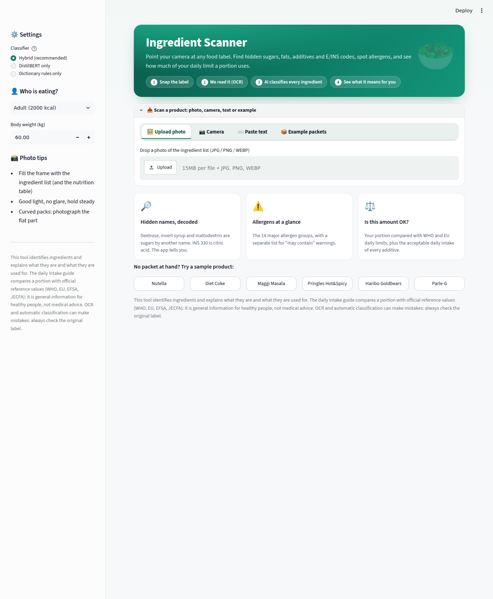
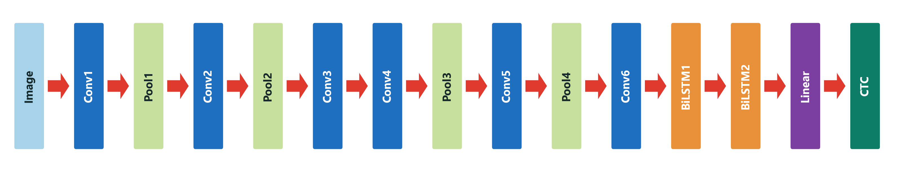
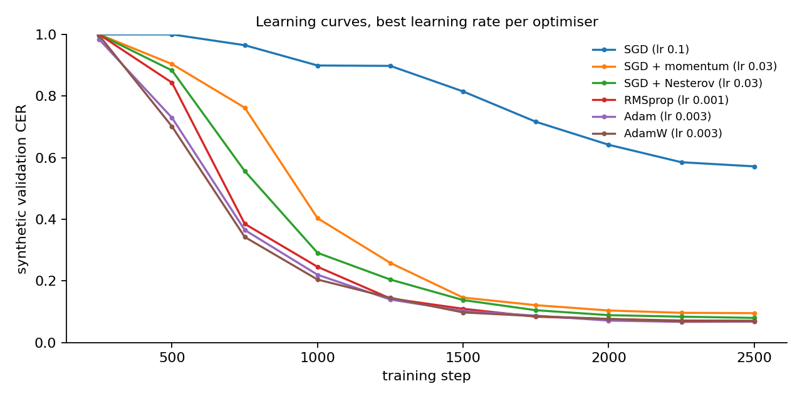
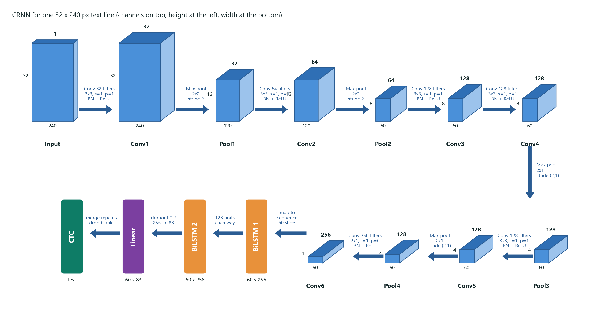
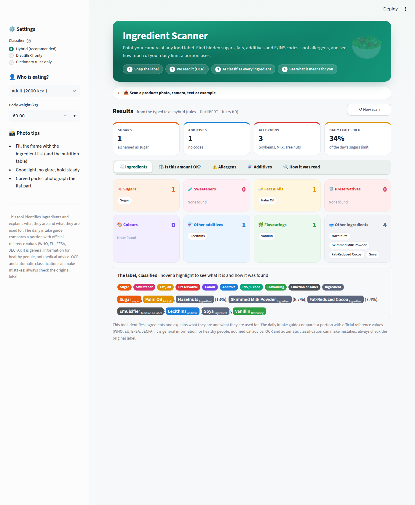
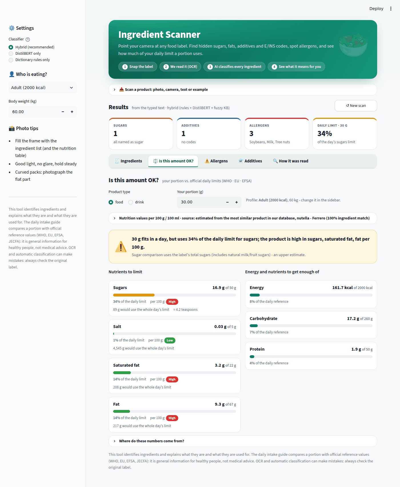
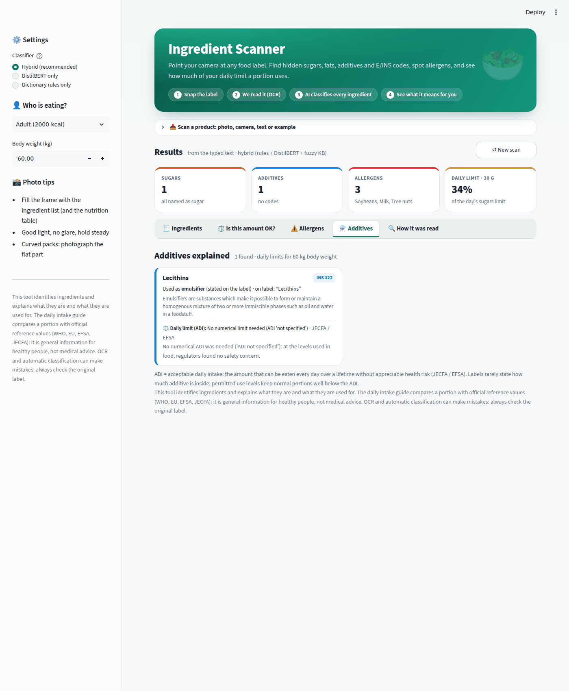
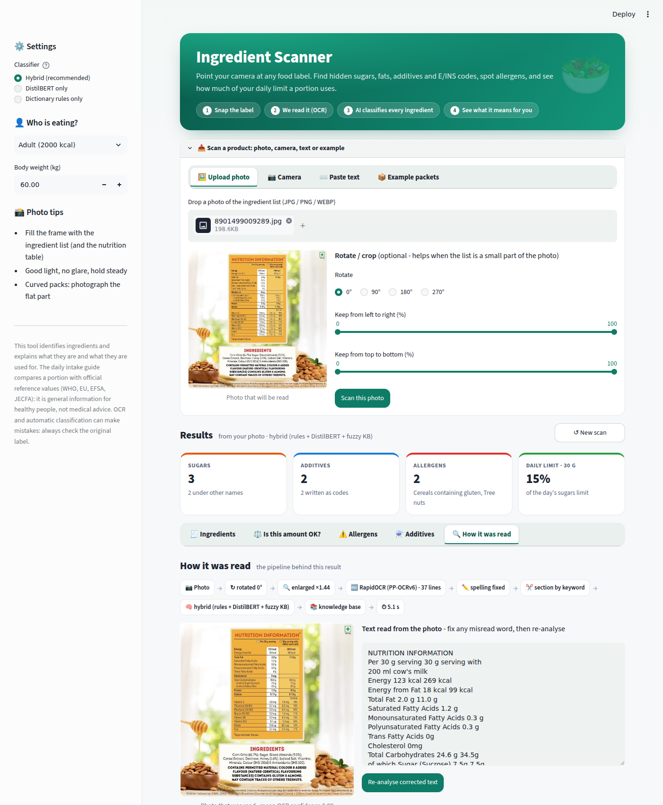

<div align="center">

# 🥫 Ingredient Scanner

**Point your phone at a food label. Get every ingredient explained.**

Two deep-learning models read a packet photo and explain what is inside: hidden sugars, additive codes,
allergens and how a portion compares with daily limits.




</div>

---

## What it does

| You give it | It tells you |
|---|---|
| A photo of an ingredient list (or pasted text) | Every ingredient, labelled: **sugar, sweetener, fat, preservative, colour, additive, flavouring…** |
| `Acidity Regulator (INS 330)` | **INS 330 → citric acid**, what it is used for, and its acceptable daily intake |
| `dextrose, invert syrup, jaggery` | These are all **sugars**, even though the word “sugar” is not there |
| `contains milk, may contain nuts` | **Allergens**, split into “contains” and “may contain” |
| A portion size and your profile | How much of the **daily sugar, salt and fat limits** the portion uses (WHO / EU reference values) |
| A question: *“Is E322 vegan?”* | An answer from the knowledge base, with its source |

> The app identifies and explains ingredients. It is general information, **not medical advice**.

## How it works

```mermaid
flowchart LR
    A[📷 Photo] --> B[Straighten, rotate,<br/>enlarge small print]
    B --> C[Find text lines<br/><i>RapidOCR detector</i>]
    C --> D[<b>Read each line</b><br/><i>our CRNN + beam search</i>]
    D --> E[Spelling fix<br/><i>SymSpell</i>]
    E --> F[Ingredient section]
    F --> G[<b>Label ingredients</b><br/><i>rules + DistilBERT + fuzzy</i>]
    G --> H[Entity linking<br/><i>731 additives</i>]
    H --> I[🧾 Categories, allergens,<br/>nutrition, assistant]
    style D fill:#0E7C66,color:#fff
    style G fill:#0E7C66,color:#fff
```



The two green steps are our deep-learning models.

### Model 1: CRNN text recogniser (built and trained from scratch)

A CNN turns a line image into a sequence of 4-pixel slices, a 2-layer bidirectional LSTM reads them with
context from both sides, and CTC turns the per-slice guesses into text. Decoding uses beam search with a
character language model trained on food ingredient lists (`"sugor"` → `"sugar"`).



| | |
|---|---|
| Architecture | 6 conv blocks (3×3 conv, BatchNorm, ReLU, max-pool) → 2 × BiLSTM (128 units each way) → linear (83 classes) → CTC |
| Parameters | 1,266,227 |
| Training data | 768,000 line images generated from 15,556 Open Food Facts ingredient lists, then 871 real line crops from Open Food Facts packet photos |
| Training | RMSprop (lr 0.001, one-cycle), batch 64, 12,000 steps on an RTX 3050 laptop GPU (27 min); chosen by a 6-optimiser study |
| Based on | Shi, Bai & Yao, [*CRNN*](https://arxiv.org/abs/1507.05717), IEEE TPAMI 2017 · Graves et al., [*CTC*](https://www.cs.toronto.edu/~graves/icml_2006.pdf), ICML 2006 |

### Model 2: DistilBERT ingredient tagger (fine-tuned)

`distilbert-base-uncased` (6 transformer layers, 12 attention heads, 66M parameters) fine-tuned to give every
word one of 21 BIO tags over 10 ingredient classes. Trained with **noise-aware augmentation**: in every epoch
half of the lists get OCR-style character errors (`dextr0se`, `Regu1ator`), so the model learns to rely on
context. It runs inside a hybrid with dictionary rules and fuzzy knowledge-base matching.

Based on Namysl et al., [*NAT: Noise-Aware Training*](https://arxiv.org/abs/2005.07162), ACL 2020, and
Sanh et al., [*DistilBERT*](https://arxiv.org/abs/1910.01108), 2019.

## Results

### Reading real packet photos (CRNN)

377 text lines from 57 real packet photos, two-fold split by photo (every line is read by a model that never
saw its photo). Lower is better.

| Version | Character error rate |
|---|---|
| Trained on generated lines only | 25.4 % |
| + harder generated lines | 19.4 % |
| + fine-tuned on real crops | 14.5 % |
| + 494 more Open Food Facts crops | 11.5 % |
| + beam search with the food language model | 9.2 % |
| **+ optimiser tuning (final)** | **8.7 %** |

On test lines in 10 fonts never used for training the CRNN makes 0.4 % character errors; training and
validation loss fall together with no overfitting.

<p align="center">
  
  
</p>

### Labelling ingredients (NER, entity F1 on 1,000 test lists)

| System | Clean text | 5 % OCR noise | 10 % OCR noise |
|---|---|---|---|
| Dictionary rules (made the reference labels) | 1.000 | 0.862 | 0.734 |
| CRF | 0.949 | 0.872 | 0.796 |
| BERT-base | 0.929 | 0.852 | 0.767 |
| DistilBERT | 0.943 | 0.834 | 0.719 |
| DistilBERT + CRF | 0.950 | 0.851 | 0.747 |
| **DistilBERT + noise training (used)** | 0.940 | **0.922** | **0.900** |

Robustness to OCR errors came from how the model was trained, not from a bigger model.
Full tables: [`reports/model_comparison.md`](reports/model_comparison.md),
[`reports/ocr_model/`](reports/ocr_model).

## Quick start

```bash
git clone https://github.com/jiahkothari-hub/IngredientScanner.git
cd IngredientScanner
python -m venv .venv && source .venv/bin/activate      # Windows: .venv\Scripts\activate
pip install torch --index-url https://download.pytorch.org/whl/cpu   # or the CUDA build for a GPU
pip install -r requirements-app.txt
streamlit run src/app/streamlit_app.py                 # http://localhost:8501
```

The first scan takes about 30 s while the models load; later scans take about 8 s on a laptop CPU.

**Docker**

```bash
docker build -t ingredient-scanner .
docker run -p 8501:8501 ingredient-scanner
```

Hosting options (Hugging Face Spaces, phone access) are in [`docs/DEPLOYMENT.md`](docs/DEPLOYMENT.md).

<details>
<summary><b>App screenshots</b></summary>

| Ingredients | Daily intake guide |
|---|---|
|  |  |
| **Additives** | **How a photo was read** |
|  |  |

</details>

## Reproducing the models

<details>
<summary><b>Data and silver labels</b></summary>

```bash
python -m src.data.download_dataset       # Open Food Facts export (~1.3 GB)
python -m src.data.filter_dataset         # 22,355 English ingredient lists
python -m src.labeling.build_silver       # rule-based (weak) BIO labels
python -m src.data.split_dataset          # train / validation / test by product
```
</details>

<details>
<summary><b>NER models</b></summary>

```bash
python -m src.ner.transformer_ner --model distilbert-base-uncased --augment --run distilbert_aug
python -m src.ner.evaluate_models         # comparison of all systems, with OCR noise
python -m src.ner.loss_curve              # training / validation / test loss curve
```
</details>

<details>
<summary><b>CRNN text recogniser</b></summary>

```bash
python -m src.ocr_model.render_lines --samples 24 --tough   # look at the generated training lines
python -m src.ocr_model.train --model crnn --tough --optimizer rmsprop --batch-size 64 --no-cycle-momentum --run crnn_tuned
python -m src.ocr_model.real_photos       # real-photo test set (line crops + labels)
python -m src.ocr_model.collect_off_crops --photos 100   # extra real crops from Open Food Facts
python -m src.ocr_model.improve_crnn --base crnn_tuned   # real-crop fine-tuning + beam search
python -m src.ocr_model.optimizer_study   # SGD / momentum / Nesterov / RMSprop / Adam / AdamW
```
A GPU is used automatically when PyTorch can see one.
</details>

## Project structure

```
src/
├── app/            Streamlit app, scanner, nutrition and daily-intake guide
├── ocr/            photo preparation, RapidOCR detection, spelling correction, section finding
├── ocr_model/      our CRNN: line generator, models, training, evaluation, recogniser for the app
├── ner/            DistilBERT / BERT / CRF taggers and the hybrid NER
├── labeling/       dictionaries and rules that make the silver labels
├── kb/             knowledge base and entity linking
├── assistant/      question answering over the knowledge base
├── embeddings/     ingredient2vec word embeddings
├── preprocessing/  normalisation, additive codes, tokenisation
├── data/           download, filtering, splitting, EDA
└── evaluation/     metrics, noise robustness, error analysis
data/               knowledge base, splits, packet photos, real line crops
models/             fine-tuned DistilBERT, CRNN, CRF, ingredient2vec
reports/            results, figures and evaluation tables
notebooks/          walkthrough notebooks
paper/              IEEE-style report (LaTeX)
tests/              pytest suite
```

## Tests

```bash
pytest -q
```

On some Windows setups an unrelated TensorFlow install breaks the `transformers` import; run
`USE_TF=0 pytest -q` in that case.

## Limitations

- **NER labels are silver** (made by our rules), so NER scores measure agreement with the rules; a 400-product gold set is prepared for human annotation.
- **Real OCR training data is small** (871 line crops); every step that added real data reduced the CRNN's error.
- **Text lines are found by RapidOCR's detector**; our CRNN reads them. A trained text detector is future work.
- **English labels only.**

## Data and credits

- Product data: [Open Food Facts](https://world.openfoodfacts.org), [ODbL](https://opendatacommons.org/licenses/odbl/1-0/); product photos CC BY-SA.
- Additive reference values: WHO, EU Regulation 1169/2011, EFSA, JECFA.
- Text detection: [RapidOCR](https://github.com/RapidAI/RapidOCR) (PaddleOCR PP-OCR models).

Detailed documentation of every pipeline step: [`docs/TECHNICAL_DETAILS.md`](docs/TECHNICAL_DETAILS.md).
