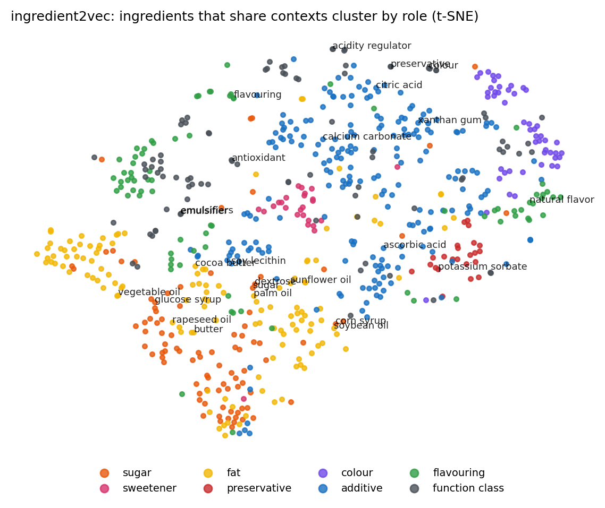

# ingredient2vec (auto-generated by `python -m src.embeddings.ingredient2vec`)

word2vec skip-gram trained on 14,066 training ingredient lists; 3,544 ingredient tokens (min count 5).

## Term classification (5-fold CV, kNN k=5, cosine)

866 terms whose category the rules know confidently: ADDITIVE 249, FAT 172, FLAVOURING 113, FUNCTION_CLASS 111, SUGAR 109, COLOUR 58, SWEETENER 30, PRESERVATIVE 24

| Representation | Accuracy | Macro F1 |
|---|---:|---:|
| Majority class (ADDITIVE) | 0.288 | - |
| Spelling (character 3-gram TF-IDF) | 0.905 | 0.858 |
| ingredient2vec (context only) | 0.739 | 0.734 |
| **Spelling + ingredient2vec** | **0.934** | **0.930** |

Per-class F1 (spelling / context / both): ADDITIVE 0.90 / 0.83 / 0.94, COLOUR 0.84 / 0.84 / 0.94, FAT 0.92 / 0.72 / 0.93, FLAVOURING 0.94 / 0.67 / 0.94, FUNCTION_CLASS 0.97 / 0.60 / 0.96, PRESERVATIVE 0.67 / 0.82 / 0.91, SUGAR 0.89 / 0.67 / 0.92, SWEETENER 0.72 / 0.73 / 0.92

Adding the context vectors fixes 57 terms that spelling alone gets wrong and breaks 32. Examples fixed: acesulfame-k (additive -> sweetener), acesulfame k (additive -> sweetener), agar (sugar -> additive), agave nectar (additive -> sugar), amylase (sugar -> additive), anthocyanin (function_class -> colour), anthocyanins (additive -> colour), aspartame (fat -> sweetener), baking soda (function_class -> additive), bht (sugar -> additive).

## Configurations compared

The configuration used above was chosen on this same evaluation, so all six are shown.

| Window | Architecture | Context only (acc / macro F1) | Spelling + context (acc / macro F1) |
|---:|---|---|---|
| 2 | CBOW | 0.741 / 0.729 | 0.931 / 0.923 |
| 2 | skip-gram | 0.663 / 0.609 | 0.930 / 0.906 |
| 3 | CBOW | 0.739 / 0.734 | 0.934 / 0.930 |
| 3 | skip-gram | 0.659 / 0.612 | 0.927 / 0.910 |
| 5 | CBOW | 0.710 / 0.693 | 0.928 / 0.917 |
| 5 | skip-gram | 0.633 / 0.585 | 0.925 / 0.907 |

## Nearest neighbours

* **sugar**: salt (0.48), dextrose (0.46), palm oil (0.45), water (0.43), brown sugar (0.40), cane sugar (0.40), cream powder (0.40), corn flour (0.40)
* **dextrose**: sugar (0.46), wheat starch (0.42), modified potato starch (0.42), salt (0.41), sodium diacetate (0.40), monocalcium phosphate (0.38), palm oil (0.37), dextrose monohydrate (0.36)
* **palm oil**: palm kernel oil (0.48), coconut oil (0.47), palm (0.46), sugar (0.45), refined palm oil (0.44), palm fat (0.42), icing sugar (0.41), cocoa powder processed with alkali (0.41)
* **citric acid**: sodium lactate (0.55), sodium diacetate (0.52), lactic acid (0.52), phosphoric acid (0.48), acetic acid (0.47), malic acid (0.47), herb (0.44), citric (0.43)
* **sucralose**: aspartame (0.71), sodium saccharin (0.62), sodium cyclamate (0.61), sodium gluconate (0.57), non-nutritive (0.56), steviol glycosides from stevia (0.55), reb a (0.53), caffeine (0.53)
* **sodium benzoate**: calcium disodium edta (0.69), potassium benzoate (0.67), sodium bisulfite (0.63), alum (0.59), sodium propionate (0.59), nisin (0.55), benzoic acid (0.55), potassium metabisulfite (0.51)
* **caramel colour**: caramel color (0.47), hydrolyzed wheat gluten (0.43), mustard bran (0.42), disodium inosinate (0.41), natural hickory smoke flavor (0.41), hydrolyzed soy protein (0.40), coloring (0.39), caramel coloring (0.39)
* **soya lecithin**: soya lecithins (0.79), sunflower lecithins (0.71), sunflower lecithin (0.61), lecithins (0.60), mono-and di-glycerides of fatty acids (0.57), soy lecithin (0.57), from soy (0.51), sucrose esters of fatty acids (0.48)
* **salt**: sea salt (0.62), sugar (0.48), water (0.46), cayenne pepper (0.45), spices (0.44), torula yeast (0.44), yeast extract (0.43), egg yolks (0.42)
* **wheat flour**: flour (0.51), riboflavin (0.46), fortified wheat flour (0.44), oat flakes (0.41), wheatflour (0.41), niacin and thiamin (0.40), bleached wheat flour (0.38), rye flour (0.38)

## Discovery: generic ingredients closest to each category (candidates to review, not labels)

* **SUGAR**: organic almonds (0.70), gluten-free oats (0.66), organic coconut (0.66), gluten free oat flour (0.62), gluten free oats (0.62), date paste (0.59), chia seed (0.59), cacao powder (0.59), pecan nuts (0.59), chicory root fiber (0.58)
* **FAT**: choco covering (0.63), ragi flour (0.61), chana dal (0.60), choco crème (0.58), rice flakes (0.57), bengal gram flour (0.56), cereal products (0.56), rice meal (0.55), peanut (0.54), hydrogenated (0.53)
* **SWEETENER**: creatine monohydrate (0.71), non-nutritive (0.71), green tea (0.67), l-glutamine (0.62), bacillus coagulans (0.60), bromelain (0.60), l-isoleucine (0.60), l-valine (0.60), green tea extract (0.59), digezyme (0.58)

